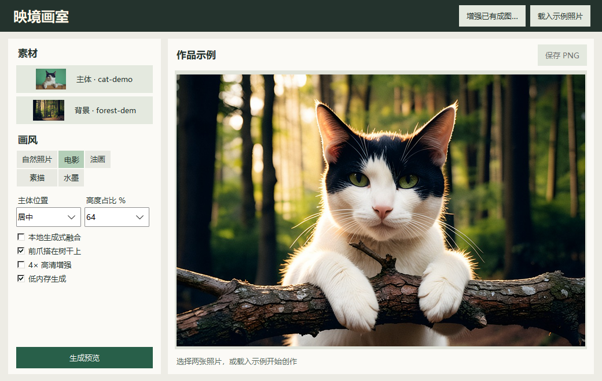
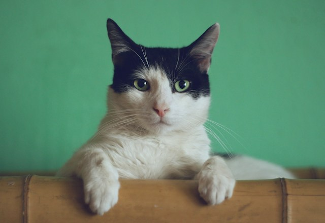
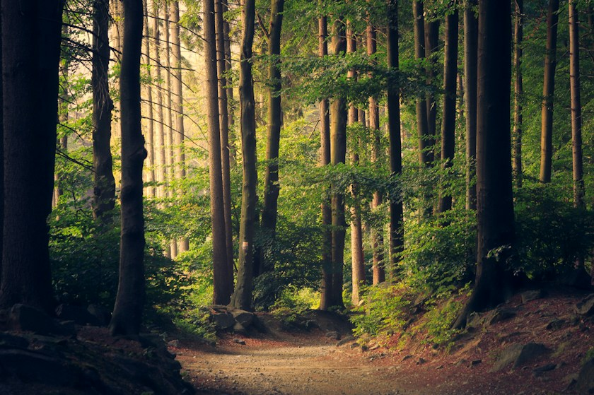
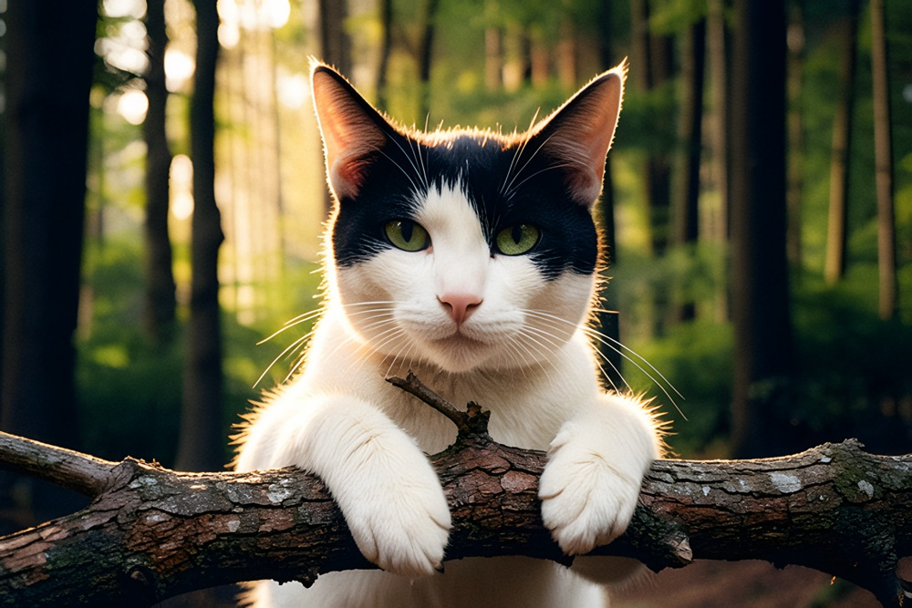

# 映境画室 · 离线 AI 照片合成与风格化工具

输入一张主体照片和一张背景照片，选择位置、占画面比例与画风，输出 PNG。基础模式用 U²-Net 分割主体，再做颜色调整与合成。生成模式把两张参考图交给本地模型，允许重绘毛发、爪部和接触阴影。可选画风包括自然照片、电影、油画、素描和水墨。



| 主体 | 背景 | 电影风格生成结果 |
| --- | --- | --- |
|  |  |  |

[查看软件实际保存的 3072 × 2048 PNG](assets/full-result.png)

## 在自己的电脑上运行

Windows x64，已验证 Python 3.8、Tkinter 及下列依赖。在仓库根目录运行：

```powershell
python -m pip install -r requirements.txt
python app/studio.py
```

点击「载入示例照片」或选择两张自己的图，然后点「生成预览」「保存 PNG」。源码自带基础抠图权重。直接运行下面的命令可核对基础模式输出，示例分辨率为 840 × 559。

```powershell
python app/studio.py --demo-output preview.png --preview-only
```

上表右侧图片使用了额外的生成与超分组件。已有高清完整版的用户可以复用解压目录中的资源，在同一 PowerShell 窗口运行：

```powershell
$install = Read-Host "请输入含 PhotoStudio.exe 的目录"
$env:PHOTOSTUDIO_RUNTIME = Join-Path $install 'local-gen'
$env:PHOTOSTUDIO_HD = Join-Path $install '_internal/hd'
python app/studio.py --generative --demo-output forest-hd.png
```

自行准备组件时，将 Windows Vulkan 版 sd-cli.exe 及配套 DLL 放在 local-gen/engine，将 flux-2-klein-4b-q4_0.gguf、Qwen3-4B-Q4_K_S.gguf 和 flux2-vae.safetensors 放在 local-gen/weights。增强程序及其 models/realesrgan-x4plus 参数和权重放在 app/hd。生成器需要支持双参考图、分组件后端与磁盘参数加载。实际参数见 [generative.py](app/generative.py)。[推理引擎](https://github.com/leejet/stable-diffusion.cpp) · [量化权重](https://huggingface.co/manishdashsharma/flux2-klein-4b-gguf) · [超分程序](https://github.com/xinntao/Real-ESRGAN)

## 实测与工程取舍

同一台 Core Ultra 7 155H、Intel Arc 核显、32 GB 内存机器，同一对输入。下表各行的计时起止点不同。

| 历史实验 | 结果 | 测量范围 |
| --- | ---: | --- |
| CPU → 混合 Vulkan | 1288.59 → 258.68 秒 | 引擎记录的单张生成时间，约 4.98 倍加速 |
| 高清版桌面操作 | 278.01 秒 | 点击生成至保存 3072 × 2048 PNG，包含超分和保存操作 |
| 标准模式 | 264.85 秒，6.77 GiB | 命令行启动至退出，含超分，进程树峰值工作集 |
| 低内存模式 | 393.96 秒，2.01 GiB | 同一命令行测量口径 |

最初直接合成时，猫爪缺少支点，毛发受光也与森林不一致。生成模式允许模型重画接触部位，因此能改善融合，但也可能改变主体细节。耗时分解显示，CPU 模式采样占 1163.07 秒。把扩散计算交给核显，文本编码与 VAE 留在 CPU，采样降到 164.28 秒。低内存模式把参数放到磁盘，关闭预取并分块解码；这组修改合计降低约 70% 峰值工作集，代价是多等约 129 秒。这里只有单设备、单组输入的记录。

[引擎 CPU 记录](evidence/test-cpu.txt) · [Vulkan 记录](evidence/test-fast.txt) · [桌面按钮计时](evidence/gui-timing.txt) · [标准模式](evidence/standard.json) · [低内存模式](evidence/low-memory.json) · [测量脚本](tools/measure_memory.py)

## 来源与复现练习

项目工作覆盖桌面交互、双图推理流程、后端配置与性能测量，使用第三方预训练模型并借助 AI 编程工具完成。基础分割权重来自 [rembg 发布的 u2netp](https://github.com/danielgatis/rembg/releases/download/v0.0.0/u2netp.onnx)，项目依据与声明见 [U²-Net](https://github.com/xuebinqin/U-2-Net) 和 [依赖声明](app/notices)。示例原图来自 Unsplash：[猫](https://images.unsplash.com/photo-1514888286974-6c03e2ca1dba) · [森林](https://images.unsplash.com/photo-1441974231531-c6227db76b6e)。前景树干是生成素材。

换一张侧光宠物照片和一个受光方向相反的背景，固定画风与位置，各跑一次基础模式和生成模式。保留两张输出，记录爪部落点、毛发轮廓和受光方向的变化，以及从点击生成到保存的耗时。这组实验可用于检验效果能否迁移到新照片。
